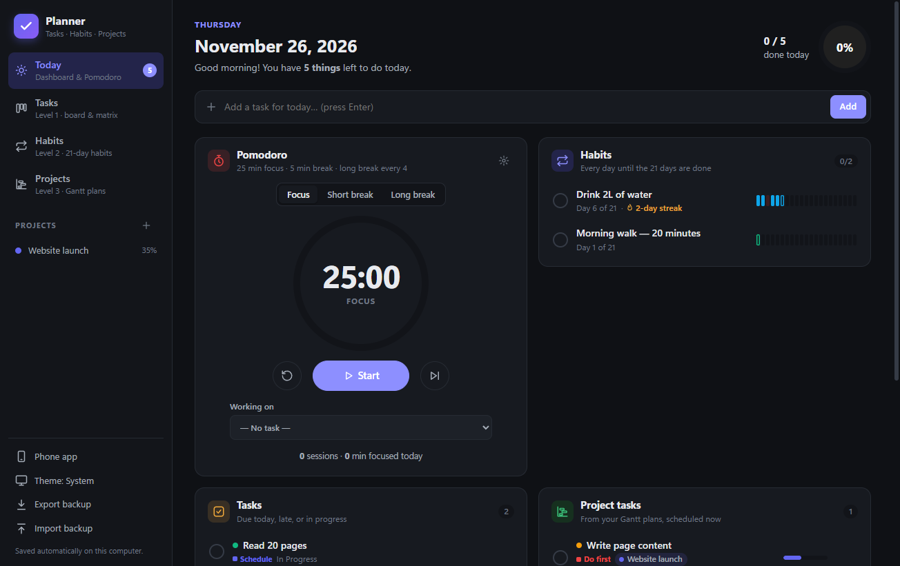
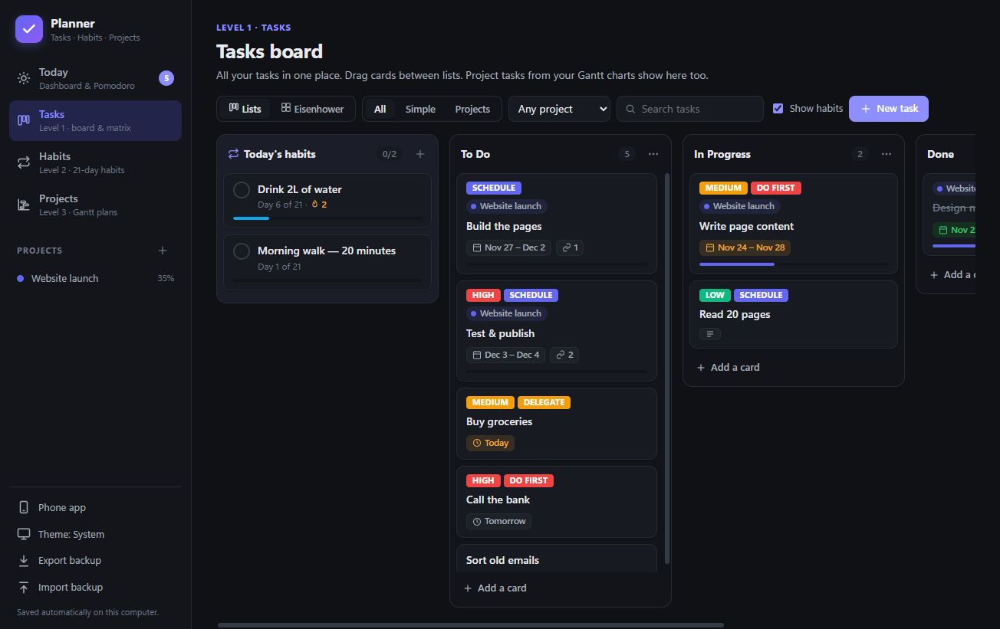
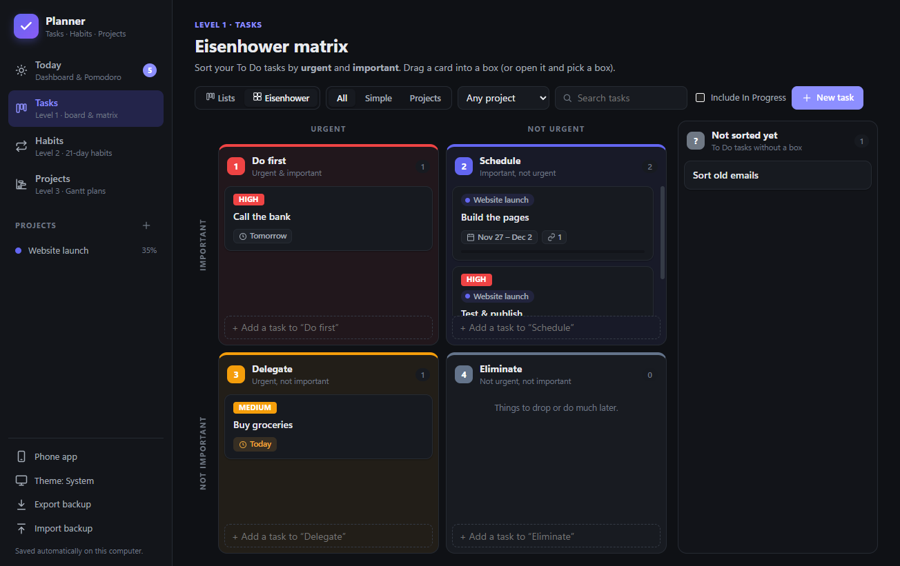
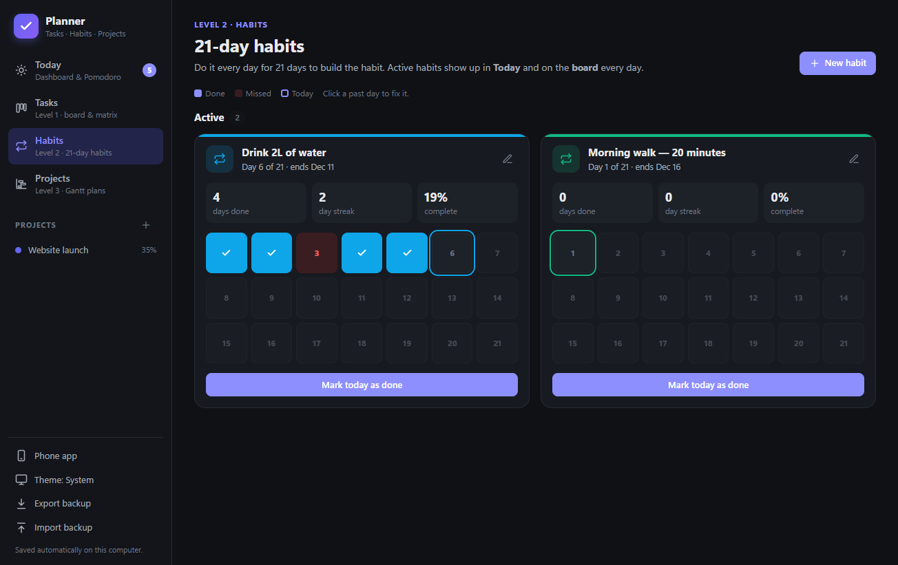
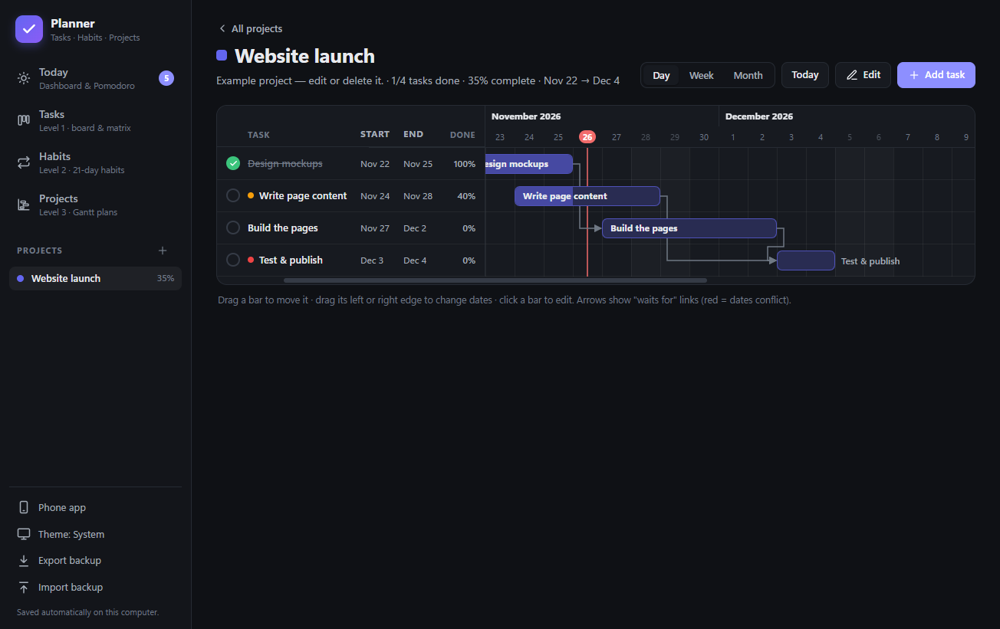
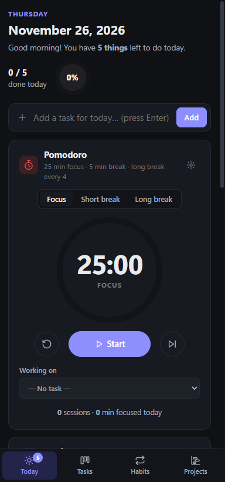
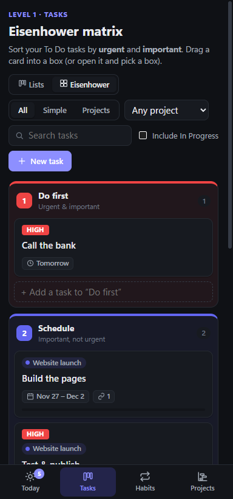
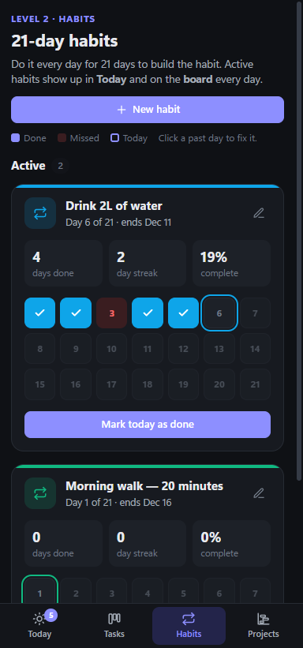

# All-in-One Planner — Kanban · Eisenhower Matrix · 21-Day Habits · Gantt · Pomodoro

**One free app for your whole day:** simple to-dos on a Trello-style board, habits you repeat for 21 days, big projects on a Gantt chart — plus a Pomodoro timer and an Eisenhower matrix to decide what matters. Runs on Windows and on your phone (over your home Wi-Fi).


### [⬇ Download for Windows](../../releases/latest)



---

## Three levels of planning

| Level | What it is | Where you find it |
|---|---|---|
| **1. Tasks** | Simple to-dos with lists, priorities and due dates | Tasks board + Eisenhower matrix |
| **2. Habits** | Something you do **every day for 21 days** | Shows up in *Today* and on the board **every day** until done |
| **3. Projects** | Bigger goals split into tasks with start & end dates | Gantt chart — and each task also appears on the board and in *Today* |

### Today dashboard
- **Pomodoro timer**: 25 min focus, 5 min break, long break every 4 (all adjustable). Pick the task you work on — finished sessions are counted on it.
- Today's habits, due and late tasks, project tasks running today, the next 7 days and what you finished.
- Quick-add a task for today in one line.

### Tasks board (Kanban)
Drag cards between lists (To Do / In Progress / Done — or add your own). Filter by type or project, search, priorities, due dates.



### Eisenhower matrix
Sort your To Do tasks into **Do first**, **Schedule**, **Delegate** and **Eliminate**. Drag cards between boxes, or open a card and pick a box. Unsorted tasks wait on the side.



### 21-day habits
A 21-day grid for each habit: done days, missed days, today, streak and progress. Click a past day to fix it. When the 21 days are over, start another round in one click.



### Projects on a Gantt chart
Drag a bar to move a task, drag its edges to change the dates, link tasks with "waits for" arrows (red when dates conflict). Day / week / month zoom. Moving a project task to *Done* on the board sets it to 100% — and the other way round.



---

## Phone app (home Wi-Fi)

| Today | Eisenhower | Habits |
|---|---|---|
|  |  |  |

1. In Planner on your PC, click **Phone app** (bottom left) and turn on **Share Planner on my Wi-Fi**.
2. If Windows asks about the firewall, click **Allow**. Your Wi-Fi must be a **Private** network
   (*Settings → Network & internet → Wi-Fi → your network → Network profile type → Private*).
3. Scan the QR code with your phone camera, then choose **Add to Home screen** in the phone browser.

The phone and the PC share the same data; changes made on both are merged item by item. The phone works while it is on the same Wi-Fi and Planner is open on the PC. A private access code protects your data on the network. To use it away from home, install the free [Tailscale](https://tailscale.com) app on both devices.

---

## Install

1. Download **Planner-Setup-x.y.z.exe** from the [latest release](../../releases/latest).
2. Run it. The installer is not code-signed, so Windows SmartScreen may warn you: click **More info → Run anyway**.
3. Open **Planner** from the Desktop or Start menu. It starts with a few example items you can delete.

**Your data stays on your computer:** `%APPDATA%\Planner\planner-data.json` (saved automatically, with a `.bak` copy). No account, no cloud. Use **Export backup / Import backup** in the sidebar to move it.

**Shortcuts:** `N` new item · `Ctrl+1…4` switch page · `Space` start/pause the timer (on Today) · `Esc` close.

Works with Windows **contrast themes** (high contrast): colors that carry meaning — project colors, progress, done/missed days — stay visible.

## Build from source

Requires [Node.js](https://nodejs.org) 20 or newer.

```powershell
git clone https://github.com/bmmahdi/all-in-one-planner-kanban-habits-gantt-pomodoro.git
cd all-in-one-planner-kanban-habits-gantt-pomodoro
npm install
npm start          # run the app
npm run dist       # build the Windows installer into dist\
```

If `npm start` says Electron failed to install, run `node node_modules/electron/install.js` once.

## How it is built

- **Electron** desktop app, plain HTML/CSS/JavaScript — no framework, no build step.
- `main.js` — window, saving to disk, and the small Wi-Fi web server for the phone app.
- `sync.js` — merges the PC and phone copies item by item (newest change wins, deletions are remembered).
- `src/` — the whole user interface (`app.js`, `styles.css`, `index.html`), shared by the desktop and the phone.

## License

[MIT](LICENSE) — free to use, change and share. Made by [@bmmahdi](https://github.com/bmmahdi).
